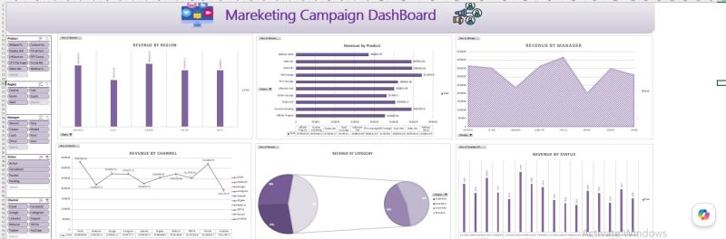

# Marketing Campaign Dashboard – Excel

An interactive Marketing Campaign Dashboard built using Microsoft Excel to analyze revenue performance across different business dimensions and present insights through dynamic visualizations.

## Project Overview

This project focuses on analyzing marketing campaign revenue using Excel dashboards and visual analytics.

The dashboard provides an overview of revenue distribution across regions, products, managers, channels, categories, and campaign statuses.

## Dashboard Preview

## Dashboard Features

The dashboard includes six main visualizations:

### 1. Revenue by Region
Analyzes revenue distribution across different geographical regions.

### 2. Revenue by Product
Compares revenue generated by different products.

### 3. Revenue by Manager
Visualizes revenue performance across managers.

### 4. Revenue by Channel
Explores revenue generated through different marketing channels.

### 5. Revenue by Category
Compares revenue distribution across product or campaign categories.

### 6. Revenue by Status
Provides a comparison of revenue across different campaign statuses.

## Interactive Features

- Interactive slicers for filtering dashboard data.
- Dynamic charts that respond to selected filters.
- Multiple views of marketing revenue performance.

## Excel Workbook Structure

The workbook contains three main sheets:

| Sheet | Description |
|---|---|
| Pivot | Interactive Marketing Campaign Dashboard |
| Pivot data | Supporting summarized data and Pivot Tables |
| Dataset | Original dataset |

## Tools & Technologies

- Microsoft Excel
- Pivot Tables
- Pivot Charts
- Interactive Slicers
- Data Visualization

## Project Objectives

- Analyze marketing revenue across different dimensions.
- Compare performance across regions, products, and managers.
- Explore revenue distribution by channels, categories, and statuses.
- Present business data through an interactive dashboard.

## Project Files

[Download the Excel Dashboard](marketing-campaign-dashboard.xlsx)

[View Dashboard Preview](marketing-campaign-excel.jpg)

---

**Project Category:** Data Analytics | Business Intelligence | Data Visualization

**Tool:** Microsoft Excel
